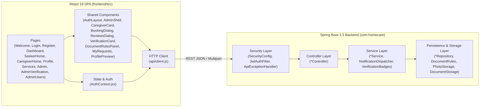
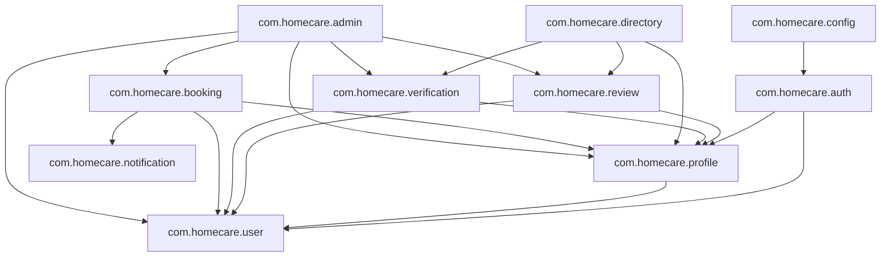
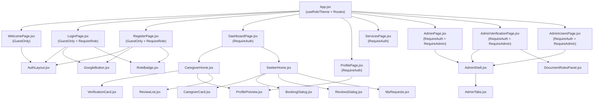

# Component Architecture

## 1. Layered Architecture Overview

HomeCare Connect follows a clean, vertical-slice **package-by-feature** architecture on the backend paired with a **role-aware component/page** architecture on the frontend.

---

## 2. Backend Layer Responsibilities

| Layer | Classes | Responsibilities |
|---|---|---|
| **Security & Cross-Cutting** | [`SecurityConfig`](file:///home/sivaram/Github/homecare-connect/backend/src/main/java/com/homecare/config/SecurityConfig.java), [`JwtAuthFilter`](file:///home/sivaram/Github/homecare-connect/backend/src/main/java/com/homecare/auth/JwtAuthFilter.java), [`ApiExceptionHandler`](file:///home/sivaram/Github/homecare-connect/backend/src/main/java/com/homecare/config/ApiExceptionHandler.java) | Stateless session policy, CORS headers, JWT extraction and principal resolution, endpoint role guards (`ROLE_CAREGIVER`, `ROLE_CARE_SEEKER`, `ROLE_ADMIN`), unified JSON error responses. |
| **REST Controllers** | [`AuthController`](file:///home/sivaram/Github/homecare-connect/backend/src/main/java/com/homecare/auth/AuthController.java), [`ProfileController`](file:///home/sivaram/Github/homecare-connect/backend/src/main/java/com/homecare/profile/ProfileController.java), [`CaregiverDirectoryController`](file:///home/sivaram/Github/homecare-connect/backend/src/main/java/com/homecare/directory/CaregiverDirectoryController.java), [`ReviewController`](file:///home/sivaram/Github/homecare-connect/backend/src/main/java/com/homecare/review/ReviewController.java), [`BookingController`](file:///home/sivaram/Github/homecare-connect/backend/src/main/java/com/homecare/booking/BookingController.java), [`AdminBookingController`](file:///home/sivaram/Github/homecare-connect/backend/src/main/java/com/homecare/booking/AdminBookingController.java), [`VerificationController`](file:///home/sivaram/Github/homecare-connect/backend/src/main/java/com/homecare/verification/VerificationController.java), [`AdminVerificationController`](file:///home/sivaram/Github/homecare-connect/backend/src/main/java/com/homecare/verification/AdminVerificationController.java), [`AdminRequirementController`](file:///home/sivaram/Github/homecare-connect/backend/src/main/java/com/homecare/verification/AdminRequirementController.java), [`AdminUserController`](file:///home/sivaram/Github/homecare-connect/backend/src/main/java/com/homecare/admin/AdminUserController.java) | HTTP routing, `@Valid` request DTO binding, `@AuthenticationPrincipal User` injection, HTTP status codes and response headers (`Cache-Control`, `X-Content-Type-Options`). Note: `CaregiverDirectoryController` is a read-only query controller that directly coordinates `CaregiverProfileRepository`, `ReviewRepository`, and `VerificationBadges`. |
| **Application Services** | [`AuthService`](file:///home/sivaram/Github/homecare-connect/backend/src/main/java/com/homecare/auth/AuthService.java), [`ProfileService`](file:///home/sivaram/Github/homecare-connect/backend/src/main/java/com/homecare/profile/ProfileService.java), [`ReviewService`](file:///home/sivaram/Github/homecare-connect/backend/src/main/java/com/homecare/review/ReviewService.java), [`BookingService`](file:///home/sivaram/Github/homecare-connect/backend/src/main/java/com/homecare/booking/BookingService.java), [`AdminBookingService`](file:///home/sivaram/Github/homecare-connect/backend/src/main/java/com/homecare/booking/AdminBookingService.java), [`NotificationService`](file:///home/sivaram/Github/homecare-connect/backend/src/main/java/com/homecare/notification/NotificationService.java), [`VerificationService`](file:///home/sivaram/Github/homecare-connect/backend/src/main/java/com/homecare/verification/VerificationService.java), [`AdminVerificationService`](file:///home/sivaram/Github/homecare-connect/backend/src/main/java/com/homecare/verification/AdminVerificationService.java), [`AdminRequirementService`](file:///home/sivaram/Github/homecare-connect/backend/src/main/java/com/homecare/verification/AdminRequirementService.java), [`AdminUserService`](file:///home/sivaram/Github/homecare-connect/backend/src/main/java/com/homecare/admin/AdminUserService.java) | Transaction demarcation (`@Transactional`), domain business rules, state machine validation, domain event publishing/listening, and post-commit file cleanup registration. |
| **Repositories & Storage** | [`UserRepository`](file:///home/sivaram/Github/homecare-connect/backend/src/main/java/com/homecare/user/UserRepository.java), [`CaregiverProfileRepository`](file:///home/sivaram/Github/homecare-connect/backend/src/main/java/com/homecare/profile/CaregiverProfileRepository.java), [`ReviewRepository`](file:///home/sivaram/Github/homecare-connect/backend/src/main/java/com/homecare/review/ReviewRepository.java), [`BookingRepository`](file:///home/sivaram/Github/homecare-connect/backend/src/main/java/com/homecare/booking/BookingRepository.java), [`NotificationRepository`](file:///home/sivaram/Github/homecare-connect/backend/src/main/java/com/homecare/notification/NotificationRepository.java), [`CaregiverDocumentRepository`](file:///home/sivaram/Github/homecare-connect/backend/src/main/java/com/homecare/verification/CaregiverDocumentRepository.java), [`DocumentRules`](file:///home/sivaram/Github/homecare-connect/backend/src/main/java/com/homecare/verification/DocumentRules.java), [`PhotoStorage`](file:///home/sivaram/Github/homecare-connect/backend/src/main/java/com/homecare/profile/PhotoStorage.java), [`DocumentStorage`](file:///home/sivaram/Github/homecare-connect/backend/src/main/java/com/homecare/verification/DocumentStorage.java) | JPQL/SQL queries, batch projections, `JdbcTemplate` access for `document_requirements`, and local disk I/O with magic-byte verification. |

---

## 3. Inter-Module Package Dependencies

The backend packages maintain clean directional boundaries:

> [!NOTE]
> Decoupling between `profile` and `verification`: `com.homecare.profile` does **not** depend on `com.homecare.verification`. Instead, when a caregiver's job changes in [`ProfileService.save`](file:///home/sivaram/Github/homecare-connect/backend/src/main/java/com/homecare/profile/ProfileService.java#L46), it publishes [`ProfileJobChanged`](file:///home/sivaram/Github/homecare-connect/backend/src/main/java/com/homecare/profile/ProfileJobChanged.java#L4), which `VerificationService` consumes via `@EventListener` to avoid a circular dependency between `profile` and `verification`.

---

## 4. Frontend Component Hierarchy

