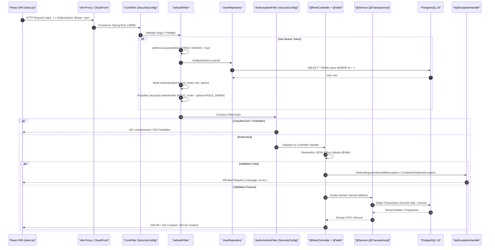

# Data Flow, Request Lifecycle & Transaction Boundaries

This document details how requests, events, database transactions, and asynchronous background tasks flow through HomeCare Connect.

---

## 1. Request Lifecycle & Execution Flow

Every HTTP request from the React SPA (or external client) traverses a deterministic pipeline in the Spring Boot backend:

### Step-by-Step Breakdown
1. **Client Request Assembly ([`client.js`](file:///home/sivaram/Github/homecare-connect/frontend/src/api/client.js#L18-L62))**:
   - Reads the JWT from `localStorage.getItem('hc_token')` and attaches `Authorization: Bearer <token>`.
   - Sets `Content-Type: application/json` unless the body is a `FormData` instance (used for multipart photo and document uploads).
2. **CORS Resolution ([`SecurityConfig.java`](file:///home/sivaram/Github/homecare-connect/backend/src/main/java/com/homecare/config/SecurityConfig.java#L85-L98))**:
   - Evaluates the `Origin` header against `app.cors.allowed-origins` (`CORS_ALLOWED_ORIGINS`, default `http://localhost:5173`).
3. **Authentication Filter ([`JwtAuthFilter.java`](file:///home/sivaram/Github/homecare-connect/backend/src/main/java/com/homecare/auth/JwtAuthFilter.java#L37-L77))**:
   - Extracts the Bearer token, verifies the HMAC-SHA256 signature and expiration via [`JwtService.parse`](file:///home/sivaram/Github/homecare-connect/backend/src/main/java/com/homecare/auth/JwtService.java#L47-L56), and queries [`UserRepository.findById`](file:///home/sivaram/Github/homecare-connect/backend/src/main/java/com/homecare/user/UserRepository.java) to ensure the user still exists and to load current `role` and `admin` flags.
   - If the token is invalid, expired, or the user was deleted, `SecurityContextHolder.clearContext()` is called and the filter chain continues anonymously.
4. **URL & Role Authorization ([`SecurityConfig.java`](file:///home/sivaram/Github/homecare-connect/backend/src/main/java/com/homecare/config/SecurityConfig.java#L41-L82))**:
   - Enforces endpoint-level access rules (`permitAll()`, `hasRole("ADMIN")`, `hasRole("CAREGIVER")`, `hasRole("CARE_SEEKER")`, or `authenticated()`).
5. **Controller Validation & Service Execution**:
   - Jakarta Bean Validation (`@Valid` on `@RequestBody` and `@Validated` on path/query parameters) runs prior to entering the controller method body.
   - Domain services execute business rules inside Spring `@Transactional` boundaries.
6. **Centralized Exception Translation ([`ApiExceptionHandler.java`](file:///home/sivaram/Github/homecare-connect/backend/src/main/java/com/homecare/common/ApiExceptionHandler.java))**:
   - Uncaught exceptions are translated into structured `ErrorResponse(String message, Map<String, String> errors)` JSON payloads with appropriate HTTP status codes.

---

## 2. Synchronous vs. Asynchronous Data Flows

HomeCare Connect combines synchronous request/response operations with two distinct internal asynchronous/deferred mechanisms:

### 2.1 Synchronous In-Transaction Event Propagation (`ProfileJobChanged`)
When a caregiver saves their profile in [`CaregiverProfileService.updateForUser`](file:///home/sivaram/Github/homecare-connect/backend/src/main/java/com/homecare/profile/CaregiverProfileService.java#L83-L108), changing or setting their `jobType` has immediate implications for whether their profile is allowed to be publicly listed (`profile.listed`).

To keep `profile` decoupled from `verification` without circular bean dependencies:
1. `CaregiverProfileService.updateForUser` publishes a [`ProfileJobChanged(userId, previousJobType, newJobType)`](file:///home/sivaram/Github/homecare-connect/backend/src/main/java/com/homecare/profile/ProfileJobChanged.java) event via Spring's `ApplicationEventPublisher`.
2. [`CaregiverVerificationService.onProfileJobChanged`](file:///home/sivaram/Github/homecare-connect/backend/src/main/java/com/homecare/verification/CaregiverVerificationService.java#L276-L280) listens synchronously via `@EventListener` within the **same database transaction**.
3. `refreshListed(userId)` queries `document_requirements` and `caregiver_documents` for the new `jobType` and updates `caregiver_profiles.listed` before the transaction commits.

### 2.2 Deferred Post-Commit File Deletion (`TransactionSynchronizationManager`)
Because caregiver photos (`uploads/photos`) and verification documents (`uploads/documents`) are stored on the local filesystem outside PostgreSQL's transactional control, deleting a file mid-transaction risks permanent data loss if the database transaction subsequently rolls back.

Both [`CaregiverVerificationService.deleteAllForUser`](file:///home/sivaram/Github/homecare-connect/backend/src/main/java/com/homecare/verification/CaregiverVerificationService.java#L254-L273) and [`AdminUserService.deleteUser`](file:///home/sivaram/Github/homecare-connect/backend/src/main/java/com/homecare/admin/AdminUserService.java#L99-L133) use `TransactionSynchronizationManager.registerSynchronization(...)`:
1. Inside the `@Transactional` method, file names are collected (`photoFile` and `caregiver_documents.file_name`).
2. The database rows are deleted (`userRepository.delete(target)` cascades across all child tables).
3. An `afterCommit()` callback is registered with `TransactionSynchronizationManager`.
4. Only after PostgreSQL commits the transaction does `afterCommit()` invoke `photoStorage.deleteIfExists(...)` and `documentStorage.deleteIfExists(...)`.

### 2.3 Asynchronous Outbox Notification Pipeline
When a care seeker submits a booking request in [`BookingService.create`](file:///home/sivaram/Github/homecare-connect/backend/src/main/java/com/homecare/booking/BookingService.java#L65-L101):
1. **Transactional Enqueue**: Within the `BookingService.create` transaction, `bookingRepository.save(booking)` persists the booking, and `notificationService.enqueueNewBookingAlerts(...)` inserts up to two `PENDING` rows (`EMAIL` and `WHATSAPP`) into the `notifications` table. The HTTP `201 Created` response returns immediately to the care seeker without waiting for SMTP or Meta Graph API calls.
2. **Scheduled Polling**: [`NotificationScheduler.tick()`](file:///home/sivaram/Github/homecare-connect/backend/src/main/java/com/homecare/notification/NotificationScheduler.java#L25-L34) triggers every `5,000 ms` (`app.notifications.poll-interval-ms`).
3. **Isolated Per-Row Dispatch**: [`NotificationDispatcher.dispatchDue()`](file:///home/sivaram/Github/homecare-connect/backend/src/main/java/com/homecare/notification/NotificationDispatcher.java#L54-L66) fetches up to 20 due rows (`status = 'PENDING' AND next_attempt_at <= now()`) and processes each row in its own `TransactionTemplate` callback:
   - Success → `markSent(now)` (`status = 'SENT'`, `sent_at = now`).
   - Transient error (`attempts < 5`) → `recordFailure(error, permanentlyFailed=false, now)` (`status = 'PENDING'`, `next_attempt_at = now + min(30s * 2^(attempts-1), 15m)`).
   - Permanent error (e.g., WhatsApp 4xx other than 429) or `attempts >= 5` → `status = 'FAILED'`.

---

## 3. Database Transaction Boundaries Summary

| Service Class | Class-Level Annotation | Method-Level Overrides & Notes |
|---|---|---|
| [`AuthService`](file:///home/sivaram/Github/homecare-connect/backend/src/main/java/com/homecare/auth/AuthService.java) | None | `@Transactional` on `register` and `loginWithGoogle` (creates user or links `google_sub`). `login` and `me` run read-only via repository defaults. |
| [`CaregiverProfileService`](file:///home/sivaram/Github/homecare-connect/backend/src/main/java/com/homecare/profile/CaregiverProfileService.java) | None | `@Transactional(readOnly = true)` on `getForUser`; `@Transactional` on `updateForUser`, `updatePhoto`, `deletePhoto`, and `setAvailability`. |
| [`DirectoryService`](file:///home/sivaram/Github/homecare-connect/backend/src/main/java/com/homecare/directory/DirectoryService.java) | None | `@Transactional(readOnly = true)` on `search`, `findPublicById`, and `findForAdminById`. Ensures `@ElementCollection` `rates` can be batch-loaded within the open Hibernate session. |
| [`ReviewService`](file:///home/sivaram/Github/homecare-connect/backend/src/main/java/com/homecare/review/ReviewService.java) | None | `@Transactional(readOnly = true)` on `listForCaregiver`, `summaryForCaregiver`, `summariesForCaregivers`; `@Transactional` on `submitReview` (upsert). |
| [`BookingService`](file:///home/sivaram/Github/homecare-connect/backend/src/main/java/com/homecare/booking/BookingService.java) | None | `@Transactional` on `create`, `cancelMine`, `adminUpdateStatus`; `@Transactional(readOnly = true)` on `listMine`, `listForAdmin`, `getForAdmin`, `countByStatus`. |
| [`NotificationService`](file:///home/sivaram/Github/homecare-connect/backend/src/main/java/com/homecare/notification/NotificationService.java) | None | `@Transactional` on `enqueueNewBookingAlerts` and `retryBookingNotifications`; `@Transactional(readOnly = true)` on `summarizeByBookingIds` and `listForBooking`. |
| [`NotificationDispatcher`](file:///home/sivaram/Github/homecare-connect/backend/src/main/java/com/homecare/notification/NotificationDispatcher.java) | None | Programmatic `TransactionTemplate` per notification ID in `dispatchOne(Long id)` so each notification's state transition commits independently. |
| [`CaregiverVerificationService`](file:///home/sivaram/Github/homecare-connect/backend/src/main/java/com/homecare/verification/CaregiverVerificationService.java) | None | `@Transactional` on `upload`, `deleteMine`, `approve`, `reject`, `setRequirement`, `refreshListed`, `deleteAllForUser`; `@Transactional(readOnly = true)` on `getMyStatus`, `loadMine`, `listCaregiversForAdmin`, `getCaregiverForAdmin`, `loadForAdmin`, `pendingCaregiverCount`, `getRequirementsMatrix`. |
| [`AdminUserService`](file:///home/sivaram/Github/homecare-connect/backend/src/main/java/com/homecare/admin/AdminUserService.java) | None | `@Transactional(readOnly = true)` on `search` and `getDetail`; `@Transactional` on `deleteUser`. |

---

## 4. Related Documents
- [Component Architecture](./component-architecture.md)
- [Authentication & Authorization Flow Diagrams](./diagrams/authentication-flow.md)
- [Core Workflow Diagrams](./diagrams/core-workflows.md)
- [Entity Relationships & Cascades](../database/entity-relationships.md)
