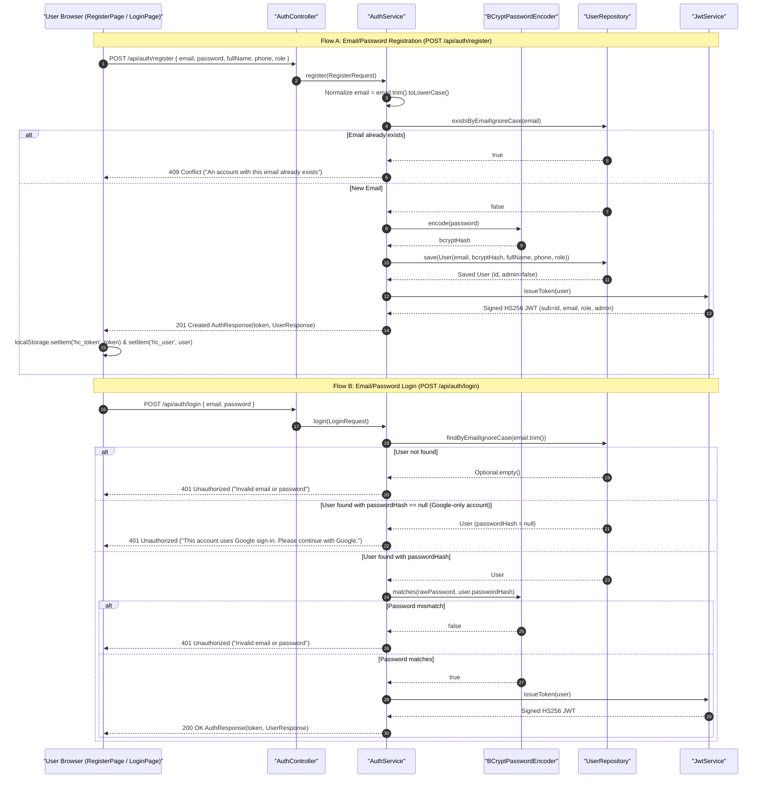
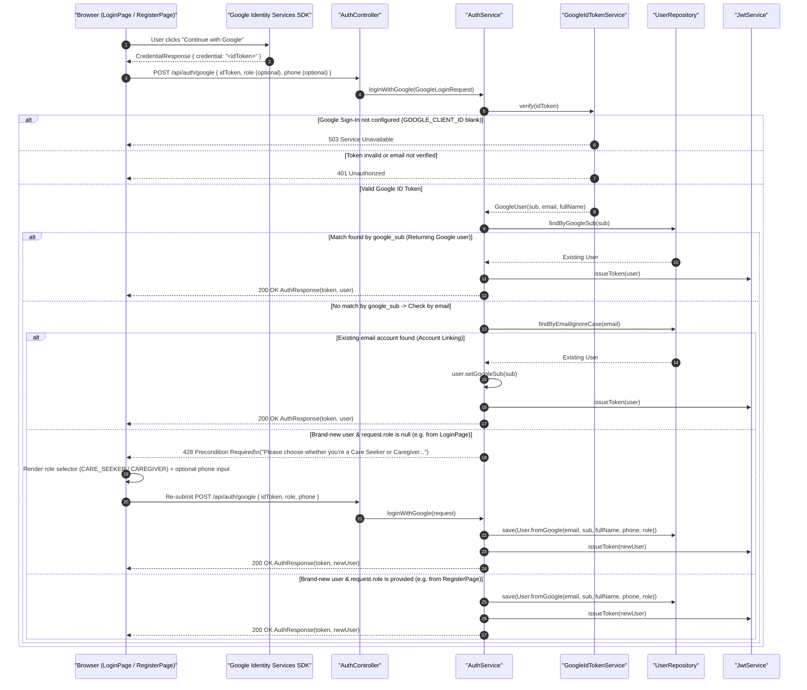
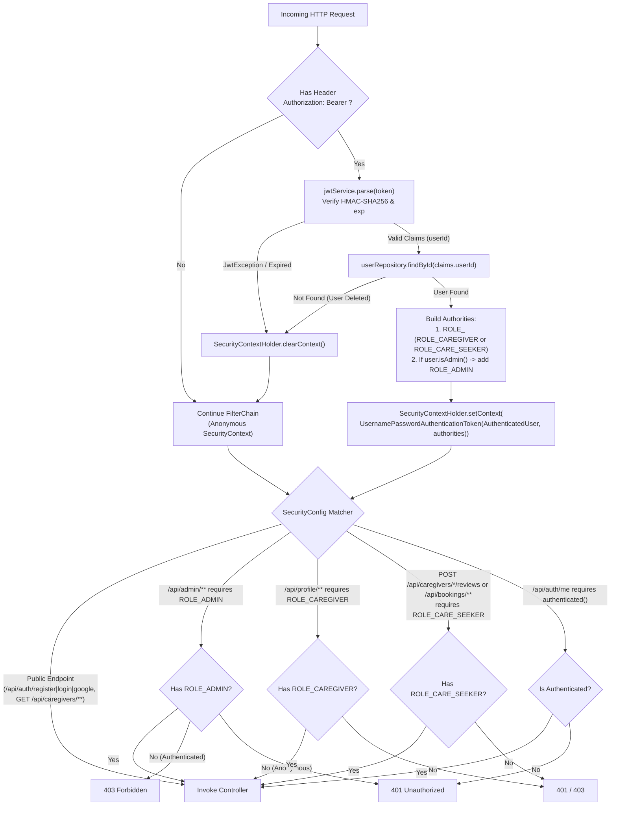

# Authentication & Authorization Flow Diagrams

This document illustrates the authentication and authorization workflows in HomeCare Connect:
1. Email & Password Registration and Sign-In
2. Google OAuth2 ID Token Sign-In (including two-step role selection for first-time users and automatic account linking)
3. Per-Request JWT Verification and Role-Based Access Control (RBAC)

---

## 1. Email & Password Registration and Sign-In

Implemented in [`AuthController.java`](file:///home/sivaram/Github/homecare-connect/backend/src/main/java/com/homecare/auth/AuthController.java) and [`AuthService.java`](file:///home/sivaram/Github/homecare-connect/backend/src/main/java/com/homecare/auth/AuthService.java#L41-L78).

---

## 2. Google OAuth2 ID Token Sign-In & Role Selection Flow

Implemented in [`AuthService.loginWithGoogle`](file:///home/sivaram/Github/homecare-connect/backend/src/main/java/com/homecare/auth/AuthService.java#L80-L120), [`GoogleIdTokenService.java`](file:///home/sivaram/Github/homecare-connect/backend/src/main/java/com/homecare/auth/GoogleIdTokenService.java), [`LoginPage.jsx`](file:///home/sivaram/Github/homecare-connect/frontend/src/pages/LoginPage.jsx), and [`RegisterPage.jsx`](file:///home/sivaram/Github/homecare-connect/frontend/src/pages/RegisterPage.jsx).

---

## 3. Per-Request JWT Verification & RBAC Resolution

Implemented in [`JwtAuthFilter.java`](file:///home/sivaram/Github/homecare-connect/backend/src/main/java/com/homecare/auth/JwtAuthFilter.java) and [`SecurityConfig.java`](file:///home/sivaram/Github/homecare-connect/backend/src/main/java/com/homecare/config/SecurityConfig.java).

