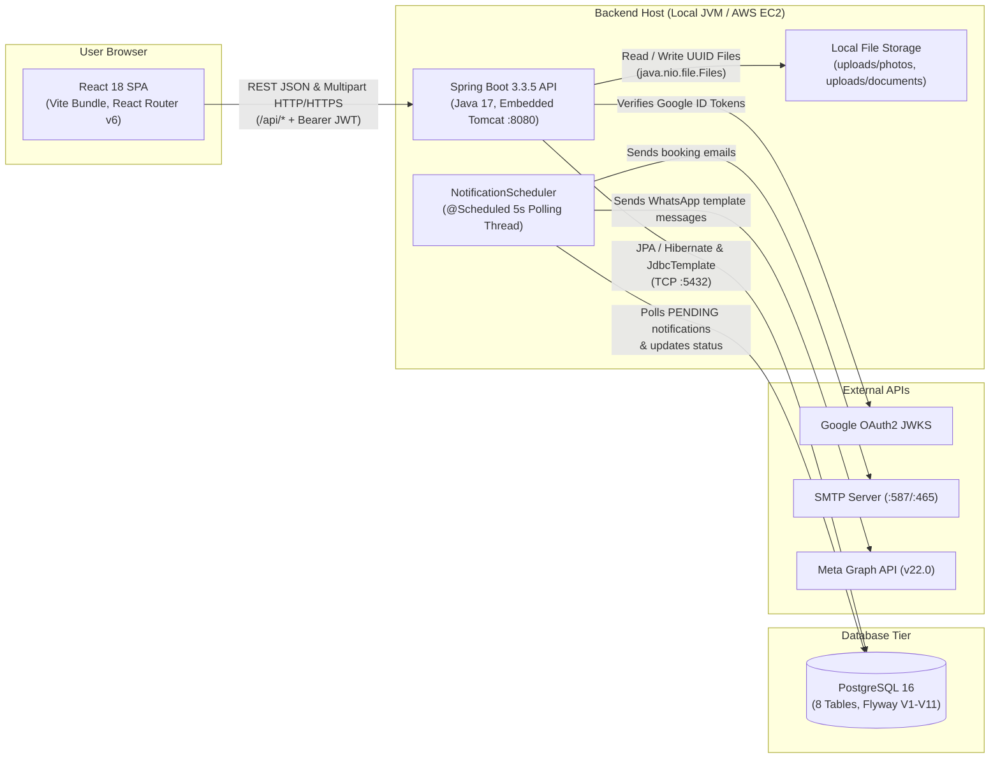
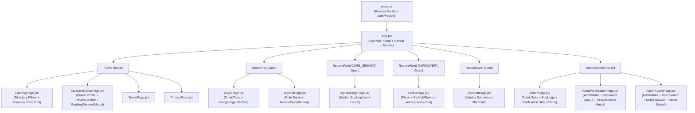

# Container & Component Architecture Diagrams (C4 Levels 2 & 3)

This document visualizes the containers (deployable runtime units) and internal backend/frontend components of HomeCare Connect.

---

## 1. Container Diagram (C4 Level 2)

---

## 2. Backend Component Diagram (C4 Level 3)

```mermaid
flowchart TB
    subgraph Security["Security & Cross-Cutting Layer"]
        SecCfg["SecurityConfig\n(FilterChain & URL Rules)"]
        JwtFilter["JwtAuthFilter\n(Bearer Token + DB Lookup)"]
        ExHandler["ApiExceptionHandler\n(@RestControllerAdvice)"]
    end

    subgraph Controllers["REST Controllers (@RestController)"]
        AuthCtrl["AuthController\n(/api/auth/*)"]
        ProfCtrl["CaregiverProfileController\n(/api/profile/me/*)"]
        VerCtrl["CaregiverVerificationController\n(/api/profile/me/documents/*)"]
        DirCtrl["DirectoryController\n(/api/caregivers/*)"]
        RevCtrl["ReviewController\n(/api/caregivers/{id}/reviews)"]
        BookCtrl["BookingController\n(/api/bookings/*)"]
        AdmBookCtrl["AdminBookingController\n(/api/admin/bookings/*)"]
        AdmVerCtrl["AdminVerificationController\n(/api/admin/verifications/*,\n/api/admin/document-requirements)"]
        AdmUserCtrl["AdminUserController\n(/api/admin/users/*)"]
    end

    subgraph Services["Domain Services (@Service)"]
        AuthSvc["AuthService\n+ JwtService + GoogleIdTokenService"]
        ProfSvc["CaregiverProfileService"]
        VerSvc["CaregiverVerificationService"]
        DirSvc["DirectoryService"]
        RevSvc["ReviewService"]
        BookSvc["BookingService"]
        NotifSvc["NotificationService"]
        NotifDisp["NotificationDispatcher\n+ NotificationScheduler"]
        AdmUserSvc["AdminUserService"]
    end

    subgraph StorageAndGateways["Storage & External Gateways"]
        PhotoStore["PhotoStorage\n(uploads/photos)"]
        DocStore["DocumentStorage\n(uploads/documents)"]
        EmailSend["EmailSender\n(SmtpEmailSender / LoggingEmailSender)"]
        WaSend["WhatsAppSender\n(WhatsAppCloudSender / LoggingWhatsAppSender)"]
    end

    subgraph Persistence["Persistence Layer (Spring Data JPA + JdbcTemplate)"]
        UserRepo["UserRepository"]
        ProfRepo["CaregiverProfileRepository"]
        DocRepo["CaregiverDocumentRepository"]
        ReqJdbc["JdbcTemplate\n(document_requirements)"]
        RevRepo["ReviewRepository"]
        BookRepo["BookingRepository"]
        NotifRepo["NotificationRepository"]
    end

    AuthCtrl --> AuthSvc
    ProfCtrl --> ProfSvc
    VerCtrl --> VerSvc
    DirCtrl --> DirSvc
    DirCtrl --> PhotoStore
    RevCtrl --> RevSvc
    BookCtrl --> BookSvc
    AdmBookCtrl --> BookSvc
    AdmBookCtrl --> NotifSvc
    AdmBookCtrl --> DirSvc
    AdmVerCtrl --> VerSvc
    AdmUserCtrl --> AdmUserSvc

    AuthSvc --> UserRepo
    ProfSvc --> ProfRepo
    ProfSvc --> PhotoStore
    ProfSvc -.->|"Publishes ProfileJobChanged"| VerSvc

    VerSvc --> DocRepo
    VerSvc --> ProfRepo
    VerSvc --> DocStore
    VerSvc --> ReqJdbc

    DirSvc --> ProfRepo
    DirSvc --> UserRepo
    DirSvc --> RevSvc

    RevSvc --> RevRepo
    RevSvc --> ProfRepo
    RevSvc --> UserRepo

    BookSvc --> BookRepo
    BookSvc --> ProfRepo
    BookSvc --> UserRepo
    BookSvc --> NotifSvc

    NotifSvc --> NotifRepo
    NotifSvc --> NotifDisp
    NotifDisp --> NotifRepo
    NotifDisp --> EmailSend
    NotifDisp --> WaSend

    AdmUserSvc --> UserRepo
    AdmUserSvc --> ProfRepo
    AdmUserSvc --> BookRepo
    AdmUserSvc --> RevRepo
    AdmUserSvc --> DocRepo
    AdmUserSvc --> VerSvc
    AdmUserSvc --> PhotoStore
```

---

## 3. Frontend Component Hierarchy Diagram

