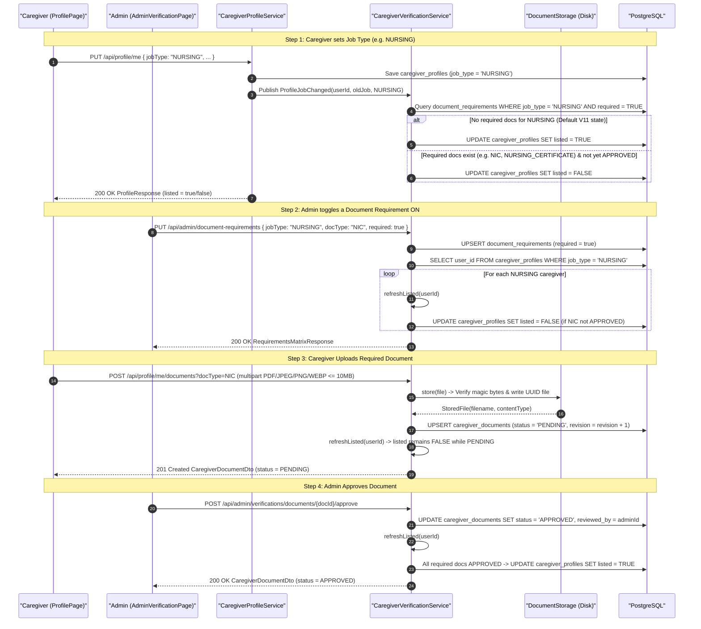
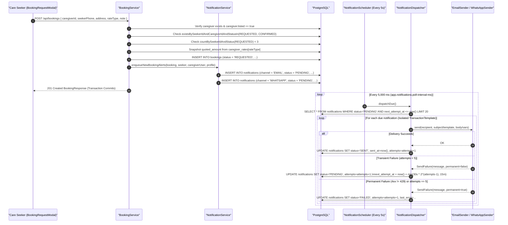
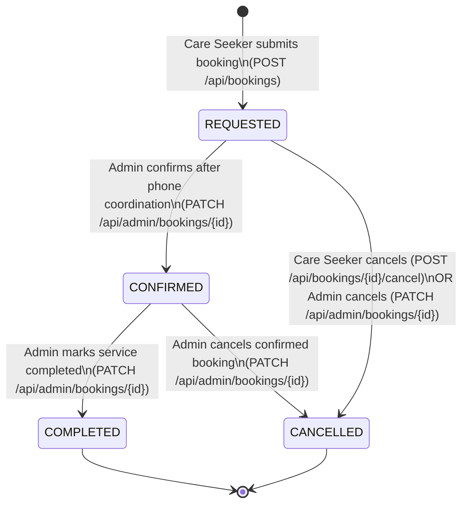
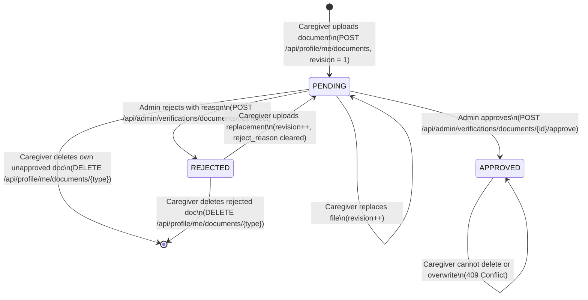
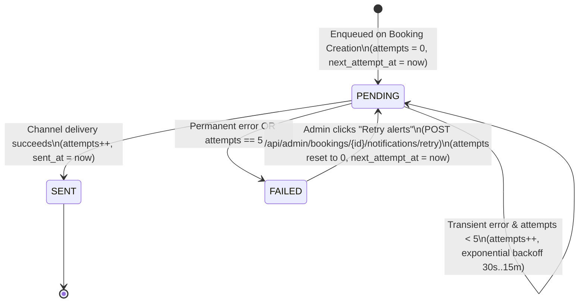
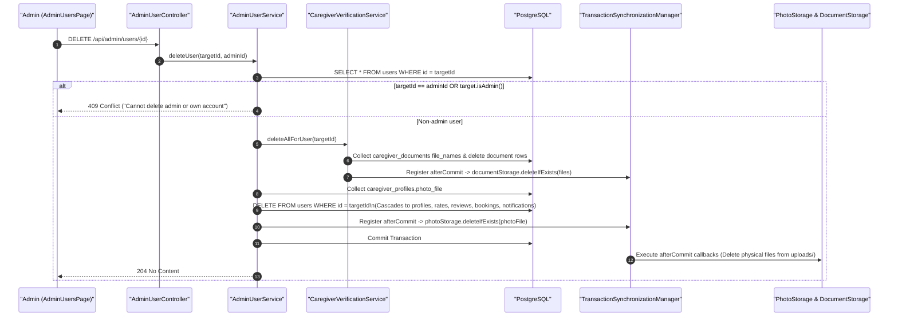

# Core Workflow & State Machine Diagrams

This document provides sequence and state machine diagrams for the core business workflows in HomeCare Connect:
1. Caregiver Profile & Document Verification Workflow (including dynamic document requirement toggling)
2. Care Seeker Booking Request & Transactional Outbox Notification Workflow
3. Entity State Machines (`BookingStatus`, `DocumentStatus`, `VerificationStatus`, and `Notification.Status`)
4. Admin Account Deletion & Post-Commit File Cleanup Workflow

---

## 1. Caregiver Verification & Dynamic Listing Eligibility Workflow

Implemented across [`CaregiverProfileService.java`](file:///home/sivaram/Github/homecare-connect/backend/src/main/java/com/homecare/profile/CaregiverProfileService.java), [`CaregiverVerificationService.java`](file:///home/sivaram/Github/homecare-connect/backend/src/main/java/com/homecare/verification/CaregiverVerificationService.java), and [`DirectoryService.java`](file:///home/sivaram/Github/homecare-connect/backend/src/main/java/com/homecare/directory/DirectoryService.java).

---

## 2. Care Seeker Booking & Outbox Notification Workflow

Implemented across [`BookingService.java`](file:///home/sivaram/Github/homecare-connect/backend/src/main/java/com/homecare/booking/BookingService.java), [`NotificationService.java`](file:///home/sivaram/Github/homecare-connect/backend/src/main/java/com/homecare/notification/NotificationService.java), [`NotificationScheduler.java`](file:///home/sivaram/Github/homecare-connect/backend/src/main/java/com/homecare/notification/NotificationScheduler.java), and [`NotificationDispatcher.java`](file:///home/sivaram/Github/homecare-connect/backend/src/main/java/com/homecare/notification/NotificationDispatcher.java).

---

## 3. Domain State Machines

### 3.1 Booking Lifecycle (`BookingStatus`)
Defined in [`BookingStatus.java`](file:///home/sivaram/Github/homecare-connect/backend/src/main/java/com/homecare/booking/BookingStatus.java) and enforced in [`BookingService.java`](file:///home/sivaram/Github/homecare-connect/backend/src/main/java/com/homecare/booking/BookingService.java#L103-L162).

### 3.2 Document Review Lifecycle (`DocumentStatus`)
Defined in [`DocumentStatus.java`](file:///home/sivaram/Github/homecare-connect/backend/src/main/java/com/homecare/verification/DocumentStatus.java) and enforced in [`CaregiverVerificationService.java`](file:///home/sivaram/Github/homecare-connect/backend/src/main/java/com/homecare/verification/CaregiverVerificationService.java#L118-L232).

### 3.3 Outbox Notification Lifecycle (`Notification.Status`)
Defined in [`Notification.java`](file:///home/sivaram/Github/homecare-connect/backend/src/main/java/com/homecare/notification/Notification.java).

---

## 4. Admin Account Deletion & Post-Commit File Cleanup

Implemented in [`AdminUserService.deleteUser`](file:///home/sivaram/Github/homecare-connect/backend/src/main/java/com/homecare/admin/AdminUserService.java#L99-L133).

