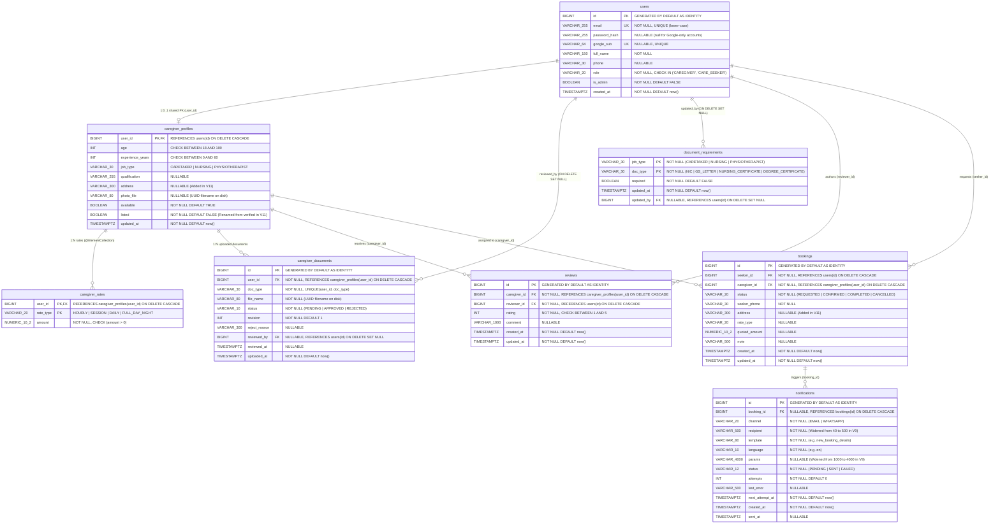

# Database Entity-Relationship (ER) Diagram

This document provides the complete Entity-Relationship diagram for all 8 tables created by Flyway migrations `V1` through `V11` in `backend/src/main/resources/db/migration/`.

---

## 1. Complete Database ER Diagram

---

## 2. Key Relationship & Constraint Summary

1. **Shared Primary Key (`users` ↔ `caregiver_profiles`)**:
   - `caregiver_profiles.user_id` is both the Primary Key and a Foreign Key referencing `users(id) ON DELETE CASCADE`. Only users with `role = 'CAREGIVER'` have a row in `caregiver_profiles` (created lazily on first profile save or photo upload).
2. **Composite Primary Keys**:
   - `caregiver_rates` uses `(user_id, rate_type)` so each caregiver has at most one price per [`RateType`](file:///home/sivaram/Github/homecare-connect/backend/src/main/java/com/homecare/profile/RateType.java).
   - `document_requirements` uses `(job_type, doc_type)` to store the global verification policy matrix.
3. **Uniqueness Constraints**:
   - `users.email` (`UNIQUE`) and `users.google_sub` (`UNIQUE`).
   - `reviews` has `CONSTRAINT uq_review_per_pair UNIQUE (caregiver_id, reviewer_id)` so a seeker can maintain only one review per caregiver (subsequent submissions update the existing review).
   - `caregiver_documents` has `CONSTRAINT uq_caregiver_document UNIQUE (user_id, doc_type)` so uploading a replacement document increments `revision` on the existing row rather than inserting a duplicate row.
4. **Cascade vs. Audit Retention on User Deletion**:
   - Deleting a row from `users` cascades (`ON DELETE CASCADE`) to `caregiver_profiles`, `caregiver_rates`, `caregiver_documents` (owned by the caregiver), `reviews` (both received and authored), `bookings` (both requested and received), and `notifications`.
   - Admin audit foreign keys (`caregiver_documents.reviewed_by` and `document_requirements.updated_by`) use `ON DELETE SET NULL` so historical approval records survive even if a former reviewer account is removed.
