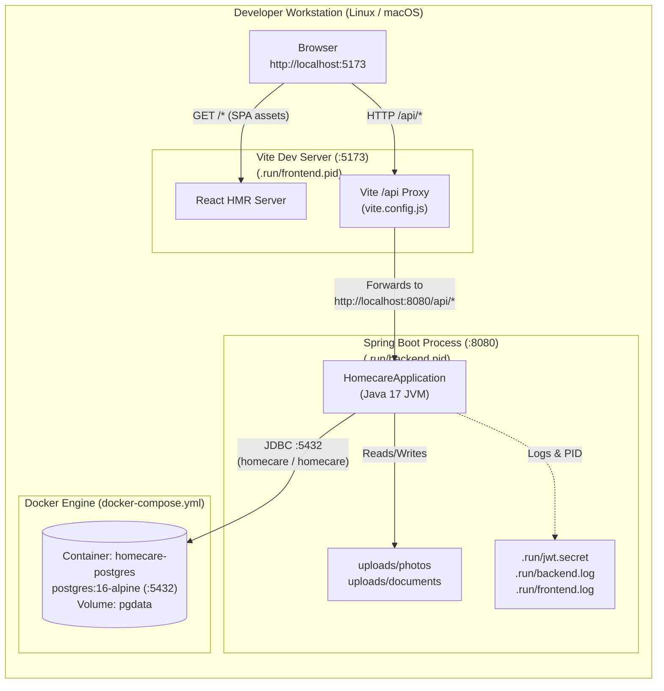
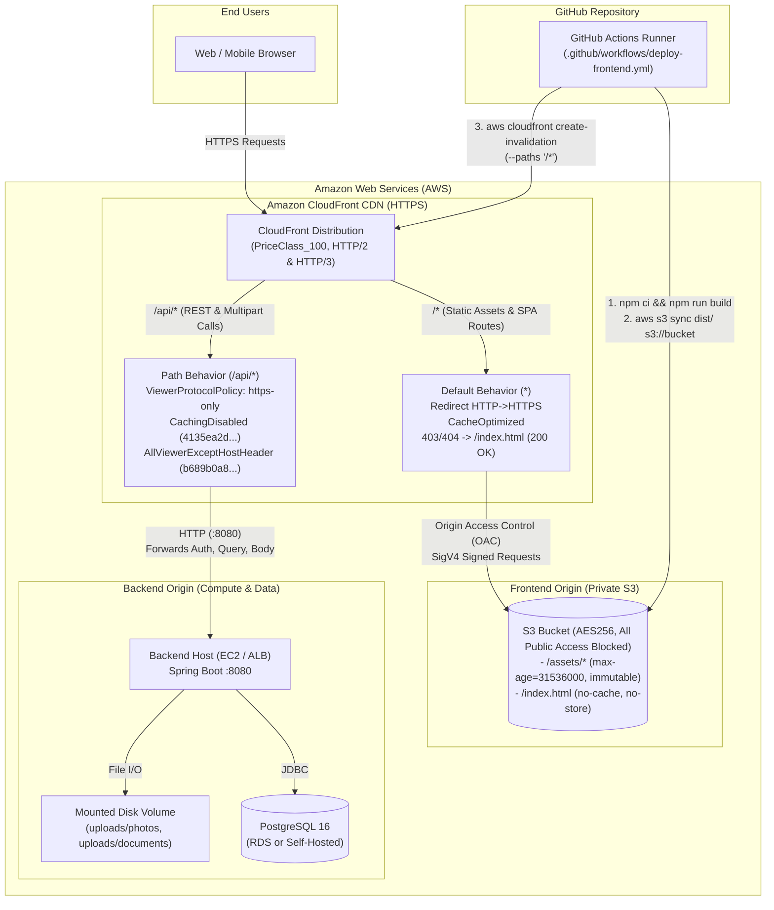

# Deployment Architecture Diagrams

This document illustrates both the **Local Development Topology** (managed by `start-service.sh` and Docker Compose) and the **AWS Production Topology** (managed by `deploy/aws/*.sh` and GitHub Actions).

---

## 1. Local Development Topology

Managed by [`start-service.sh`](file:///home/sivaram/Github/homecare-connect/start-service.sh) and [`docker-compose.yml`](file:///home/sivaram/Github/homecare-connect/docker-compose.yml).

---

## 2. AWS Production & CI/CD Topology

Provisioned via [`setup-s3-cloudfront.sh`](file:///home/sivaram/Github/homecare-connect/deploy/aws/setup-s3-cloudfront.sh), [`add-api-origin-cloudfront.sh`](file:///home/sivaram/Github/homecare-connect/deploy/aws/add-api-origin-cloudfront.sh), [`deploy-frontend.sh`](file:///home/sivaram/Github/homecare-connect/deploy/aws/deploy-frontend.sh), and [`.github/workflows/deploy-frontend.yml`](file:///home/sivaram/Github/homecare-connect/.github/workflows/deploy-frontend.yml).

---

## 3. Why CloudFront Proxies `/api/*` in Production

In [`add-api-origin-cloudfront.sh`](file:///home/sivaram/Github/homecare-connect/deploy/aws/add-api-origin-cloudfront.sh), the EC2 backend is attached as a custom HTTP origin behind the same CloudFront distribution that serves the S3 frontend:
1. **Eliminates Mixed-Content Blocks**: Browsers block `https://<cloudfront-domain>` pages from calling an `http://<ec2-ip>:8080` API directly (`Mixed Content`). By routing `/api/*` through CloudFront (`VITE_API_BASE_URL=""`), the browser communicates exclusively over HTTPS with CloudFront, while CloudFront forwards `/api/*` requests to the EC2 origin over HTTP.
2. **Eliminates Cross-Origin Preflight Overhead**: Serving both `/*` and `/api/*` from the same CloudFront origin makes all API requests same-origin from the browser's perspective.
3. **Header & Query Forwarding**: Using AWS managed `OriginRequestPolicy` `AllViewerExceptHostHeader` (`b689b0a8-53d0-40ab-baf2-68738e2966ac`) and `CachePolicy` `CachingDisabled` (`4135ea2d-6df8-44a3-9df3-4b5a84be39ad`) ensures `Authorization: Bearer <jwt>`, query filters (`?jobType=...`), and multipart upload bodies reach Spring Boot untouched and uncached.
