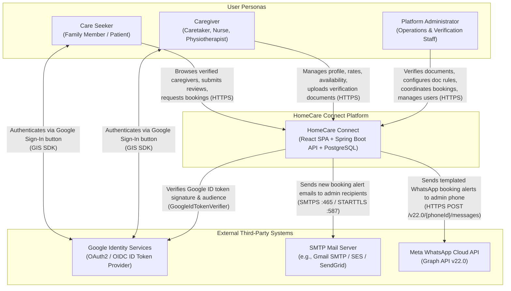

# System Context Diagram (C4 Level 1)

This document illustrates the system context for **HomeCare Connect**, showing its three user personas and three external third-party integrations.

---

## 1. C4 System Context Diagram

---

## 2. Actors & Personas

| Actor | Role / Privilege in Database | Key Interactions |
|---|---|---|
| **Care Seeker** | `users.role = 'CARE_SEEKER'` | Searches the public caregiver directory, views public profiles (with caregiver phone/email stripped), submits 1–5 star ratings and reviews, and creates/cancels booking requests. |
| **Caregiver** | `users.role = 'CAREGIVER'` | Completes professional profile (age, experience, job type, qualifications, residential area, rates), toggles availability, and uploads identity/qualification documents (`NIC`, `GS_LETTER`, `NURSING_CERTIFICATE`, `DEGREE_CERTIFICATE`) for verification. |
| **Platform Administrator** | `users.is_admin = true` (orthogonal to `role`) | Reviews caregiver verification documents (approving/rejecting), dynamically configures mandatory document rules per job type, manages booking lifecycle (`REQUESTED` -> `CONFIRMED` -> `COMPLETED`/`CANCELLED`), inspects/retries notification deliveries, and audits/deletes non-admin user accounts. |

---

## 3. External System Integrations

| External System | Direction | Protocol & Authentication | Implementation Location | Fallback / Local Mode |
|---|---|---|---|---|
| **Google Identity Services (GIS)** | Inbound ID token from client; outbound JWKS key fetch by backend | HTTPS / OIDC RSA signature verification via `com.google.api-client:google-api-client:2.7.0` | [`GoogleIdTokenService.java`](file:///home/sivaram/Github/homecare-connect/backend/src/main/java/com/homecare/auth/GoogleIdTokenService.java) & [`GoogleSignInButton.jsx`](file:///home/sivaram/Github/homecare-connect/frontend/src/components/GoogleSignInButton.jsx) | Disabled when `GOOGLE_CLIENT_ID` / `VITE_GOOGLE_CLIENT_ID` are blank (`503 Service Unavailable` on backend; button hidden on frontend). |
| **SMTP Server** | Outbound from backend | SMTP over SSL (`:465`) or STARTTLS (`:587`) via `spring-boot-starter-mail` (`JavaMailSenderImpl`) | [`EmailConfig.java`](file:///home/sivaram/Github/homecare-connect/backend/src/main/java/com/homecare/notification/EmailConfig.java) & [`SmtpEmailSender.java`](file:///home/sivaram/Github/homecare-connect/backend/src/main/java/com/homecare/notification/SmtpEmailSender.java) | When `EMAIL_ENABLED=false` (default), [`LoggingEmailSender`](file:///home/sivaram/Github/homecare-connect/backend/src/main/java/com/homecare/notification/LoggingEmailSender.java) logs the email payload in test mode. |
| **Meta WhatsApp Cloud API** | Outbound from backend | HTTPS `POST https://graph.facebook.com/v22.0/{phoneNumberId}/messages` with Bearer access token | [`WhatsAppConfig.java`](file:///home/sivaram/Github/homecare-connect/backend/src/main/java/com/homecare/notification/WhatsAppConfig.java) & [`WhatsAppCloudSender.java`](file:///home/sivaram/Github/homecare-connect/backend/src/main/java/com/homecare/notification/WhatsAppCloudSender.java) | When `WHATSAPP_ENABLED=false` (default), [`LoggingWhatsAppSender`](file:///home/sivaram/Github/homecare-connect/backend/src/main/java/com/homecare/notification/LoggingWhatsAppSender.java) logs the template variables in test mode. |
