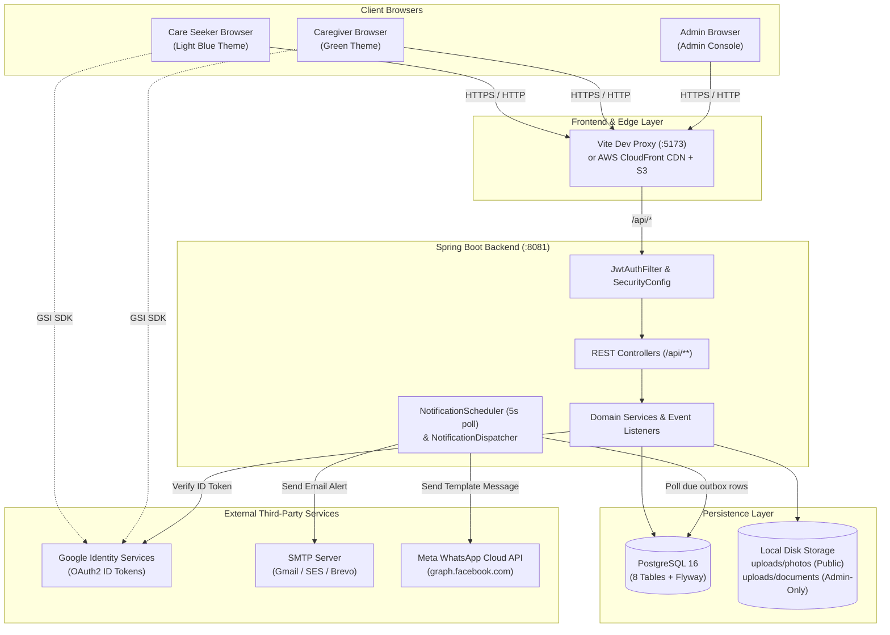

# System Overview

## 1. Purpose and Domain Scope

**HomeCare Connect** is a specialized two-sided home-healthcare marketplace built for connecting families (**Care Seekers**) with verified home-care professionals (**Caregivers**) across three care disciplines:
- **Caretaker (`CARETAKER`)**: Daily living assistance, companionship, and home support.
- **Nursing (`NURSING`)**: Qualified medical care, medication administration, and wound care.
- **Physiotherapist (`PHYSIOTHERAPIST`)**: Rehabilitation, mobility recovery, and exercise therapy.

Unlike self-serve payment marketplaces, HomeCare Connect uses a **human-in-the-loop concierged booking model**:
1. Caregivers create profiles, list their rates in Sri Lankan Rupees (`LKR`), toggle availability, and upload identity/qualification documents (`NIC`, `GS_LETTER`, `NURSING_CERTIFICATE`, `DEGREE_CERTIFICATE`).
2. Administrators review uploaded documents, decide which document types are optional vs. mandatory per job category, and receive real-time alerts (via **SMTP Email** or **Meta WhatsApp Cloud API**) whenever a Care Seeker requests a caregiver.
3. Administrators contact the Care Seeker by phone, coordinate the care arrangement with the Caregiver, and transition the booking request through its lifecycle (`REQUESTED` -> `CONFIRMED` -> `COMPLETED` or `CANCELLED`).

---

## 2. User Personas & Capabilities

| Persona | Account Representation | Primary Capabilities |
|---|---|---|
| **Care Seeker** | `users.role = 'CARE_SEEKER'` | Browse available & listed caregivers by job category; view prices, experience, qualifications, verified badges, and reviews; submit booking requests (up to 3 open `REQUESTED` at once); cancel waiting requests; post/update 1–5 star reviews. |
| **Caregiver** | `users.role = 'CAREGIVER'` + 1:1 row in `caregiver_profiles` | Build profile (name, age, experience, address, job type, qualifications, rates across 4 rate types, profile photo); toggle work availability; upload/replace verification documents; track profile completeness percentage; read received reviews. |
| **Administrator** | Any user with `users.is_admin = true` | View all booking requests with seeker/caregiver private addresses and contact numbers; advance booking statuses; monitor and resend failed/test-mode notification alerts; view, approve, or reject caregiver documents; toggle mandatory document requirements per job with live impact previews; search and permanently delete non-admin accounts. |

---

## 3. Technology Stack

| Layer | Technology | Version | Implementation Reference |
|---|---|---|---|
| **Frontend SPA** | React, React Router DOM, Vite | React `^18.3.1`, Router `^6.27.0`, Vite `^5.4.10` | [`frontend/package.json`](file:///home/sivaram/Github/homecare-connect/frontend/package.json) |
| **Backend API** | Java, Spring Boot (Web, Security, Data JPA, Validation, Mail) | Java `17`, Spring Boot `3.3.5` | [`backend/pom.xml`](file:///home/sivaram/Github/homecare-connect/backend/pom.xml) |
| **Authentication** | JJWT (HMAC-SHA JWT), Google API Client (`GoogleIdTokenVerifier`), BCrypt | JJWT `0.12.6`, Google API Client `2.7.0` | [`JwtService.java`](file:///home/sivaram/Github/homecare-connect/backend/src/main/java/com/homecare/auth/JwtService.java), [`GoogleIdTokenService.java`](file:///home/sivaram/Github/homecare-connect/backend/src/main/java/com/homecare/auth/GoogleIdTokenService.java) |
| **Database & Migrations** | PostgreSQL (Production/Dev), H2 (Test), Flyway | PostgreSQL `16`, Flyway Core | [`docker-compose.yml`](file:///home/sivaram/Github/homecare-connect/docker-compose.yml), [`backend/src/main/resources/db/migration/`](file:///home/sivaram/Github/homecare-connect/backend/src/main/resources/db/migration) |
| **External Messaging** | Jakarta Mail (`JavaMailSenderImpl`), Meta WhatsApp Cloud API (`RestClient`) | Spring Boot Starter Mail / Web | [`SmtpEmailSender.java`](file:///home/sivaram/Github/homecare-connect/backend/src/main/java/com/homecare/notification/SmtpEmailSender.java), [`WhatsAppCloudSender.java`](file:///home/sivaram/Github/homecare-connect/backend/src/main/java/com/homecare/notification/WhatsAppCloudSender.java) |
| **Cloud Infrastructure** | AWS S3 (Private + OAC), AWS CloudFront, AWS EC2, GitHub Actions | AWS CLI v2, GitHub Actions v4 | [`deploy/aws/`](file:///home/sivaram/Github/homecare-connect/deploy/aws), [`.github/workflows/deploy-frontend.yml`](file:///home/sivaram/Github/homecare-connect/.github/workflows/deploy-frontend.yml) |

---

## 4. High-Level System Architecture

---

## 5. Key Architectural Characteristics

1. **Strict Privacy Separation**:
   - Caregiver **profile photos** (`uploads/photos/{uuid}.{ext}`) are publicly readable so families can browse caregiver cards.
   - Caregiver **identity & qualification documents** (`uploads/documents/{uuid}.{ext}`) are stored in a separate directory, never exposed on public URLs, served with `Cache-Control: no-store`, and accessible exclusively to authenticated administrators via [`AdminVerificationController.file`](file:///home/sivaram/Github/homecare-connect/backend/src/main/java/com/homecare/verification/AdminVerificationController.java#L43-L52).
   - Caregiver **email, phone, and residential address** are stripped from public directory cards ([`CaregiverCard` DTO](file:///home/sivaram/Github/homecare-connect/backend/src/main/java/com/homecare/profile/ProfileDtos.java#L34-L37)) and visible only to administrators.
2. **Reliable Outbox Alert Delivery**:
   - Booking requests and their admin notification rows are persisted atomically in the same database transaction ([`BookingService.create`](file:///home/sivaram/Github/homecare-connect/backend/src/main/java/com/homecare/booking/BookingService.java#L65-L70)), ensuring slow or unavailable SMTP/WhatsApp servers never block or lose a family's booking request.
3. **Dynamic Listing Visibility (`caregiver_profiles.listed`)**:
   - A materialized boolean column `listed` on `caregiver_profiles` controls whether a caregiver appears in seeker searches. It is automatically recomputed whenever a caregiver uploads/removes a document, changes their `jobType`, has a document reviewed by an admin, or when an admin toggles a mandatory document requirement for that job.
