# CI/CD Pipeline (`.github/workflows/deploy-frontend.yml`)

HomeCare Connect uses GitHub Actions to build and deploy the React frontend to Amazon S3 and invalidate the Amazon CloudFront CDN cache.

---

## 1. Workflow Overview

Source: [`.github/workflows/deploy-frontend.yml`](file:///home/sivaram/Github/homecare-connect/.github/workflows/deploy-frontend.yml)

### Triggers
1. **`push` to `main` branch** when any of the following paths change:
   - `frontend/**`
   - `.github/workflows/deploy-frontend.yml`
2. **`workflow_dispatch`** (manual trigger from the GitHub Actions UI).

### Concurrency Control
```yaml
concurrency:
  group: frontend-deploy
  cancel-in-progress: false
```
Ensures only one frontend deployment runs at a time and queues subsequent deployments rather than cancelling an in-progress S3 sync or CloudFront invalidation.

---

## 2. Execution Steps

```mermaid
flowchart LR
    Trigger["Push to main (frontend/**)\nor workflow_dispatch"] --> Checkout["actions/checkout@v4"]
    Checkout --> SetupNode["actions/setup-node@v4\n(Node 20, npm cache)"]
    SetupNode --> Install["npm ci\n(working-directory: frontend)"]
    Install --> Build["npm run build\n(VITE_API_BASE_URL, VITE_GOOGLE_CLIENT_ID)"]
    Build --> AwsAuth["aws-actions/configure-aws-credentials@v4\n(IAM Access Key + Secret)"]
    AwsAuth --> S3Assets["aws s3 sync dist/ s3://BUCKET\n(--exclude index.html, max-age=31536000)"]
    S3Assets --> S3Index["aws s3 cp dist/index.html s3://BUCKET/index.html\n(no-cache, no-store, must-revalidate)"]
    S3Index --> CFInvalidate["aws cloudfront create-invalidation\n(--paths '/*')"]
```



---

## 3. Required GitHub Secrets & Variables

Configure these in **GitHub Repository Settings -> Secrets and variables -> Actions**:

### Repository Secrets (`secrets.*`)
| Secret Name | Purpose |
|---|---|
| `AWS_ACCESS_KEY_ID` | IAM access key with permissions defined in [`github-actions-deploy-policy.json`](file:///home/sivaram/Github/homecare-connect/deploy/aws/github-actions-deploy-policy.json). |
| `AWS_SECRET_ACCESS_KEY` | Corresponding IAM secret access key. |

### Repository Variables (`vars.*`)
| Variable Name | Required? | Purpose |
|---|---|---|
| `AWS_REGION` | **Yes** | AWS region of the S3 bucket (e.g., `us-east-1`). |
| `S3_BUCKET` | **Yes** | Target S3 bucket name (`homecare-connect-web-...`). |
| `CLOUDFRONT_DISTRIBUTION_ID` | **Yes** | CloudFront Distribution ID (`E1234567890ABC`) to invalidate after upload. |
| `VITE_GOOGLE_CLIENT_ID` | Optional | Google OAuth 2.0 Web Client ID baked into the frontend bundle. |

---

## 4. Known Configuration Drift & Recommendations

### 4.1 Hardcoded `VITE_API_BASE_URL` Fallback in `deploy-frontend.yml`
In [`.github/workflows/deploy-frontend.yml` (line 36)](file:///home/sivaram/Github/homecare-connect/.github/workflows/deploy-frontend.yml#L36):
```yaml
env:
  VITE_API_BASE_URL: ${{ vars.VITE_API_BASE_URL || 'http://18.212.164.25:8080' }}
```
- **Why this matters**: In GitHub Actions, if `vars.VITE_API_BASE_URL` is set to an empty string `""` or left unset, `${{ vars.VITE_API_BASE_URL || 'http://18.212.164.25:8080' }}` evaluates to `'http://18.212.164.25:8080'`.
- **Runtime Mitigation Already Present**: Because the site is served over `https://` via CloudFront, [`resolveApiBase()` in `frontend/src/api/client.js`](file:///home/sivaram/Github/homecare-connect/frontend/src/api/client.js#L1-L14) detects that `http://18.212.164.25:8080` starts with `http://` on an `https:` page, logs a console warning, and falls back to `''` (routing `/api/*` through CloudFront).
- **Recommended Clean Fix**: Remove the `|| 'http://18.212.164.25:8080'` fallback from `.github/workflows/deploy-frontend.yml` so `VITE_API_BASE_URL` defaults cleanly to `""`.

### 4.2 Adding a Backend CI Workflow (`mvn test`)
Currently, there is no GitHub Actions workflow running `./mvnw test` on pull requests or pushes affecting `backend/**`. Adding a `.github/workflows/backend-ci.yml` workflow that runs `./mvnw test` on Java 17 is recommended to gate merges on the 11 JUnit test suites.
